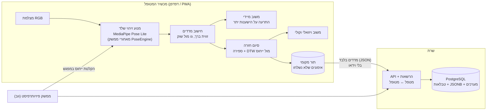

# החלטות ארכיטקטורה: טיוטה לאישור M1

> המסמך מתעדכן לפי תוצאות ה-POC (`results/summary.json`, לשונית **תוצאות POC** באתר).
> החלטה שמסומנת **[ממתין לנתונים]** תיסגר אחרי הבדיקה המתאימה.

## תרשים

## ההחלטות

| # | החלטה | חלופות שנבחנו | מבוסס על | מצב |
|---|---|---|---|---|
| 1 | **עיבוד במכשיר**. לשרת נשלחים רק מדדים בסוף האימון | עיבוד בשרת, שילוב | בדיקת ביצועים בטלפונים; עלות העלאת וידאו מול נקודות שלד (`analysis`, test_server_vs_device); פרטיות (סיכון 4) | **עבר באייפון:** במכשיר 21 ms לפריים, השהיה 38 ms. בשרת: 13.4 ms לפריים, אבל העלאת וידאו (640px, ‏15fps) דורשת ~6.4 Mbps, פי 99 מנקודות שלד (65 kbps), והווידאו יוצא מהבית. ממתין לאנדרואיד |
| 2 | **MediaPipe Pose Lite**, עטוף בממשק `PoseEngine` | Full, YOLO-Pose | FPS ודיוק לפי תנאי צילום | Lite עמד בזמן אמת באייפון; זיהוי שלד ב-93% מהפריימים בסרטונים. דיוק בתנאי צילום: ממתין לסרטוני cond_* |
| 3 | **אפליקציית ווב (PWA)** עם MediaPipe Tasks for Web | Flutter, React Native, Kotlin | ל-MediaPipe יש תמיכה רשמית בווב ובאנדרואיד ואין לו תמיכה רשמית ב-Flutter/RN; קוד אחד לאייפון ולאנדרואיד; ממשק המטפל ממילא ווב. ווב היא הדרך האיטית ביותר להריץ את המנוע, ולכן אם היא עומדת בקריטריון, נייטיב יעמוד בוודאי | [ממתין לנתונים] |
| 4 | **PostgreSQL**: טבלאות לישויות, `REAL[]` לרצפי זוויות, `JSONB` לספים | MongoDB | `db/benchmark.py`: אותן 5 שאילתות, אותן תשובות; מפתחות זרים כבסיס להרשאות (סיכון 4); היכרות הצוות עם SQL (מגבלה 2) | **הוחלט.** 752,760 חזרות: תשובות זהות בכל 5 השאילתות; PostgreSQL מהיר או שווה למונגו בכולן (Q2, לוח המטפל: 0.97 ms מול 4.3 ms) |
| 5 | **צילום מהצד מזווית קבועה** + בדיקת מיקום לפני אימון (כל המפרקים נראים, visibility ≥ 0.5) | צילום חזיתי | מטריצת תנאי הצילום | [ממתין לנתונים] |
| 6 | **משוב בשתי שכבות**: ספים בזמן התנועה, DTW בסוף חזרה | DTW בלבד, סיווג ML | מאמר [2]; אין מאגר מתויג לאימון מסווג | הוחלט (סקר ספרות) |
| 7 | **ייחוס**: אחת או ממוצע של שלוש הקלטות | | טסט יציבות ייחוס | **הוחלט: ממוצע של 3 הקלטות.** ייחוס יחיד: 17% התרעות שווא (נכשל, הסף 10%); ממוצע של 3: ‏0%. מדגם: 15 חזרות תקינות (6 לכיול, 6 לבדיקה) |
| 8 | **תנועת פיצוי ראשונה: הישענות יתר בסקווט** (גו מול שוק). סף 38° (כויל בבדיקה חיה: תקין 16–29°, נשען 49°; מתחיל ב-20° שגרם להתרעות שווא) | | NASM OHSA; טסט זיהוי על סרטוני lean_* | **עבר:** בסרטונים: תקין 17.7–25.6°, נשען 37.6–45.8°; בסף 38°: זיהוי 90% (9/10), התרעות שווא 0% (0/15). **ממצא:** בבדיקה החיה (מצלמה קדמית, העמדה אחרת) תקין הגיע עד 34.7°, כלומר הערכים תלויים בהעמדת המצלמה. **מסקנה לתכן:** הסף ייקבע לכל מטופל מהקלטת הייחוס שלו (הישענות בייחוס + מרווח), ולא כמספר קבוע. ממתין לאישור פיזיותרפיסט |

## פתוח לשלב הבא
- התאמת ציון המערכת להערכת פיזיותרפיסט (דורש פיזיותרפיסט).
- תנועות פיצוי נוספות (הרמת כתף, סיבוב אגן).
- טסט הסיווג המלא, 3 תרגילים (לפני הדוח ההנדסי, 03.03.27).
