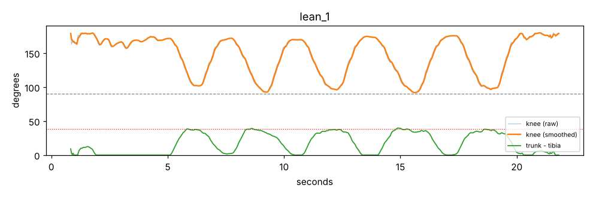
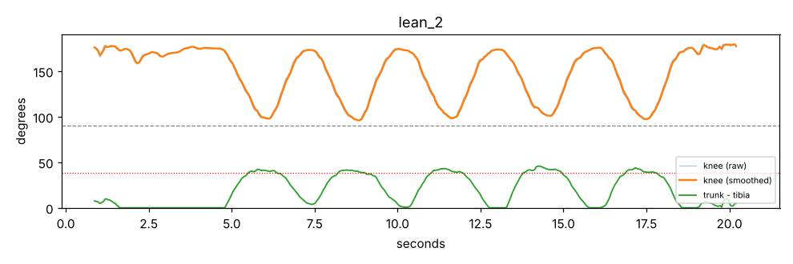
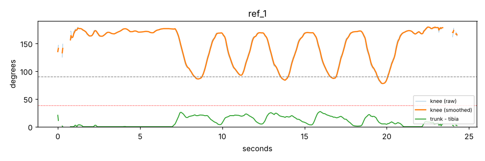
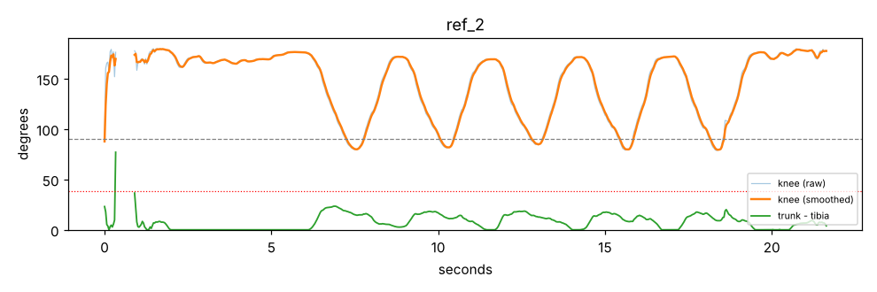
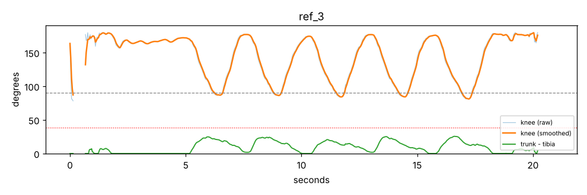

# Poseitive: תוצאות שלב ה-POC

עודכן: 2026-10-17T12:06:30.441798+00:00

| אי-ודאות | קריטריון | תוצאה | מצב | החלטה |
|---|---|---|---|---|
| חילוץ שלד ומשוב בזמן אמת על סמארטפון | ≥ 15 FPS, השהיה ≤ 0.5 שנ׳ | iPhone 13: 30.0 FPS, השהיה 38 ms | pass | מנוע MediaPipe Pose Lite במכשיר |
| זיהוי שלד יציב בתנאי צילום ביתיים | סטייה ≤ 10° ב-90% מהפריימים | ממתין לסרטוני cond_* | pending | – |
| הבחנה בין ביצוע תקין לשגוי (DTW + זוויות) | זיהוי ≥ 80% מהשגויים, התרעות שווא ≤ 15% | ראשוני: זוהו 90% מהחזרות השגויות (DTW על זווית הברך) | partial | – |
| זיהוי תנועת פיצוי: הישענות יתר קדימה בסקווט | זיהוי ≥ 80%, התרעות שווא ≤ 15%. אישור פיזיותרפיסט | זיהוי 90%, התרעות שווא 0% (סף 38.0°, סף מוצע 31.6°) | pass | מדד גו מול שוק מצילום צידי |
| הקלטת ייחוס אחת מול ממוצע של שלוש | התרעות שווא ≤ 10% | ייחוס יחיד: 17% התרעות שווא; ממוצע של 3: 0% | pass | ייחוס ממוצע של 3 הקלטות |
| התאמת המדדים להערכת פיזיותרפיסט | מתאם בין ציון המערכת לדירוג המטפל | דורש פיזיותרפיסט. מתוכנן לשלב הבא | open | – |
| מיקום העיבוד: מכשיר, שרת או שילוב | השהיה, נתוני רשת, פרטיות | שרת: 13.4 ms לפריים. העלאת וידאו: ~6447.0 kbps לעומת 65.3 kbps לנקודות שלד | pass | עיבוד במכשיר; לשרת נשלחים רק מדדים |
| טכנולוגיית האפליקציה (ווב / Flutter / Kotlin) | ביצועים מספיקים בפלטפורמה שנבחרה | אפליקציית ווב עמדה בקריטריון על המכשירים שנבדקו. ווב היא הדרך האיטית ביותר להריץ את המנוע, ולכן התוצאה מחמירה | pass | אפליקציית ווב (PWA) עם MediaPipe Tasks for Web |
| מסד נתונים: רלציוני מול מסמכים | שאילתות ממשק המטפל, פשטות, ביצועים | PostgreSQL. כל 5 השאילתות מחזירות תשובות זהות בשני המסדים; היחס הגרוע ביותר PG/Mongo: 1.02 (Q5_weekly_lean_trend). | pass | PostgreSQL |

## גרפים

המספרים המלאים: `results/poc_results.json`.